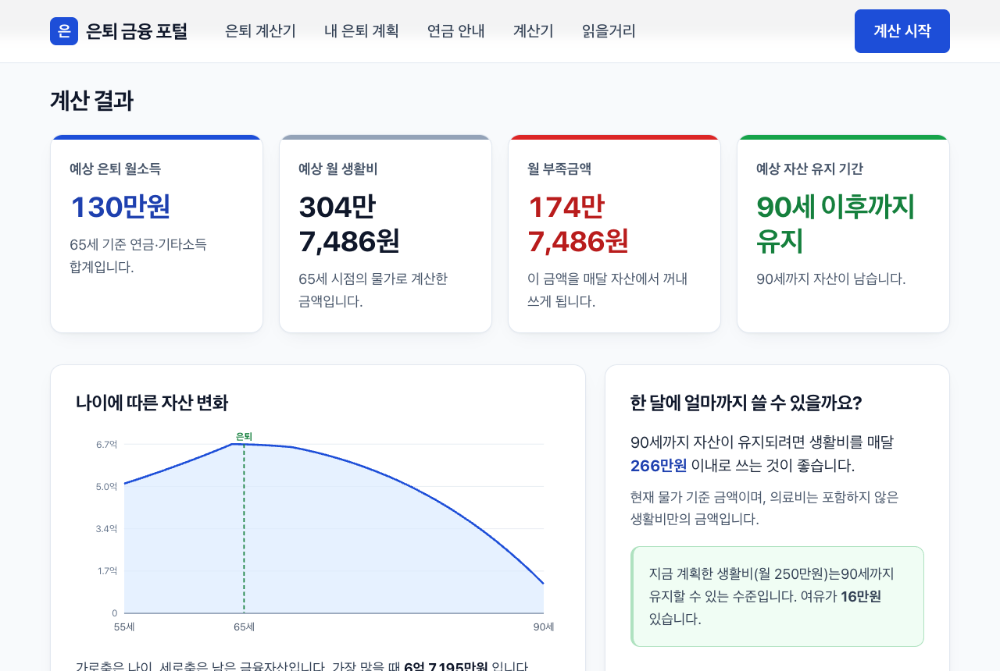
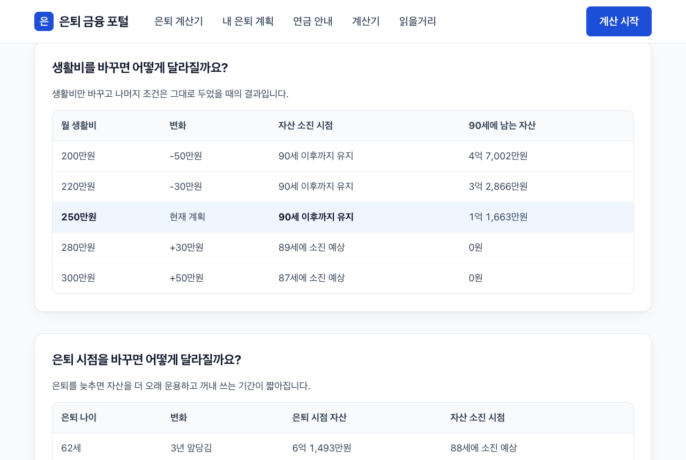
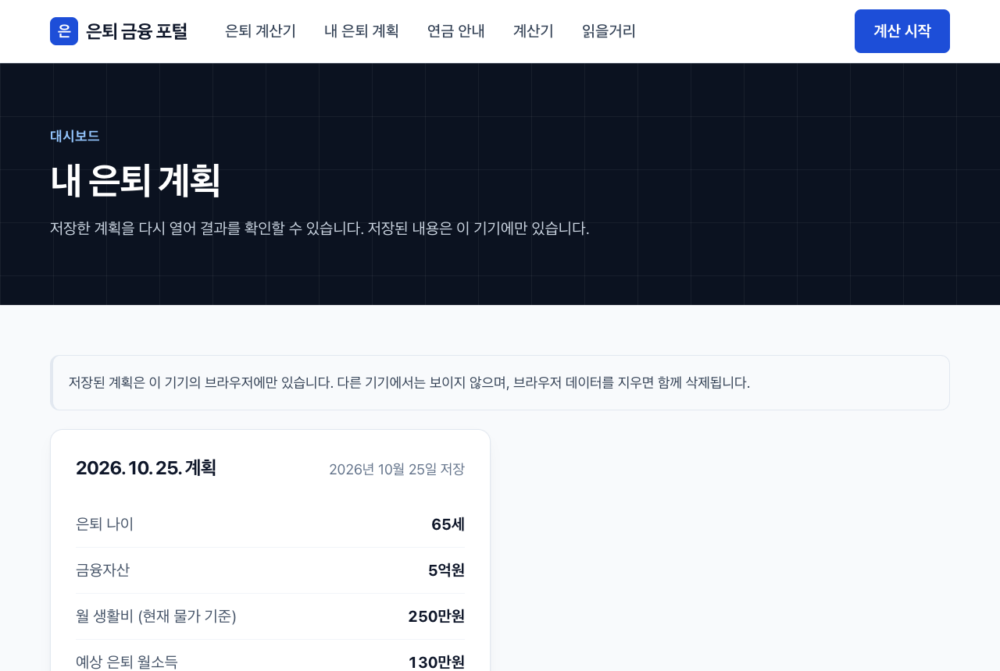
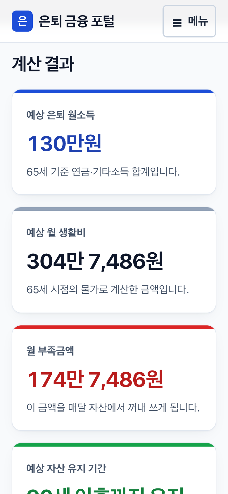

# 은퇴 금융 포털

대한민국의 은퇴 예정자와 은퇴자를 위한 금융·노후생활 포털입니다.

> **"현재 자산과 연금으로 은퇴 후 매달 얼마를 쓸 수 있고, 내 자산은 언제까지 유지될까?"**

이 질문에 답하는 것이 이 서비스의 목적입니다. 주식 종목 추천이나 단기 투자정보는 다루지 않습니다.
총자산보다 **은퇴 후 월 현금흐름과 자산이 유지되는 기간**을 보여주는 데 집중합니다.

- 운영 주소: https://finance-portal-beige.vercel.app/
- 주 사용자: 50~70대. 큰 글씨, 큰 버튼, 단계별 입력, 쉬운 우리말 설명을 기본으로 합니다.
- 회원가입 없이 사용합니다. 입력한 값은 사용하는 기기의 브라우저에만 저장되고 서버로 보내지 않습니다.

---

## 화면 소개

아래 화면은 운영 사이트에서 찍었습니다 (2026-10-25 기준).
계산 화면에는 다음 예시 값을 넣었습니다.

| 항목 | 예시 값 |
|---|---|
| 현재 나이 / 은퇴 나이 / 기대수명 | 55세 / 65세 / 90세 |
| 금융자산 | 5억원 |
| 국민연금 | 월 130만원, 65세부터 |
| 월 생활비 | 250만원 (현재 물가 기준) |
| 가정 | 물가상승률·투자수익률은 기본값 |

### 1. 첫 화면


서비스가 알려주는 숫자 네 가지를 첫 화면에서 바로 설명합니다.

1. **예상 은퇴 월소득**: 국민연금·퇴직연금·기타소득을 합쳐 매달 들어오는 돈
2. **예상 월 생활비**: 은퇴 후 매달 쓰게 될 돈 (물가상승 반영)
3. **월 부족금액**: 생활비에서 소득을 뺀 금액. 이만큼을 자산에서 꺼내 씁니다
4. **예상 자산 유지 기간**: 지금 계획대로라면 금융자산이 몇 살까지 유지되는지

"은퇴 계산 시작하기" 버튼으로 바로 계산기로 들어갑니다.

### 2. 은퇴 계산기: 4단계 입력


한 화면에서 너무 많은 값을 받지 않도록 네 단계로 나눠 입력합니다.

| 단계 | 입력 내용 |
|---|---|
| 1단계 · 나이 | 현재 나이, 은퇴 나이, 기대수명 |
| 2단계 · 금융자산 | 예금·투자 등 금융자산 합계 |
| 3단계 · 연금과 기타소득 | 국민연금, 퇴직·개인연금, 기타소득과 각각 받기 시작하는 나이 |
| 4단계 · 생활비와 가정 | 월 생활비, 의료비 포함 여부, 물가상승률·투자수익률 가정 |

- 왼쪽에는 지금 몇 단계인지 보여주는 단계 목록이 있습니다.
- 오른쪽에는 지금까지 입력한 값을 모아서 보여줍니다.
- 금액은 직접 입력하거나 `−` `+` 버튼으로 조절할 수 있습니다.
- 잘못된 값은 다음 단계로 넘어가기 전에 이유와 함께 알려줍니다. 예를 들어 월 생활비는 10만원 이상이어야 합니다.

### 3. 계산 결과: 핵심 숫자와 자산 변화



예시 값으로 계산하면 다음과 같이 나옵니다.

- **예상 은퇴 월소득 130만원**: 65세에 은퇴하면서 바로 국민연금을 받는 경우입니다.
- **예상 월 생활비 304만 7,486원**: 지금 기준 250만원이 10년 동안의 물가상승을 반영해 늘어난 금액입니다.
- **월 부족금액 174만 7,486원**: 이 금액을 매달 자산에서 꺼내 쓰게 됩니다.
- **예상 자산 유지 기간: 90세 이후까지 유지**: 기대수명까지 자산이 남습니다.

결과에는 다음 내용도 함께 나옵니다.

- **자산 변화 그래프**: 나이에 따라 금융자산이 어떻게 늘고 줄어드는지 보여주고, 은퇴 시점과 자산 소진 시점을 점선으로 표시합니다. 그래프만으로 읽기 어려운 분을 위해 같은 내용을 글로도 설명합니다.
- **한 달에 얼마까지 쓸 수 있을까요?**: 기대수명까지 자산이 유지되는 최대 월 생활비입니다. 예시에서는 266만원(현재 물가 기준)이고, 지금 계획에 16만원의 여유가 있다고 알려줍니다.

### 4. 계산 결과: 조건을 바꿔 비교



조건을 하나만 바꿨을 때 결과가 어떻게 달라지는지 표로 비교합니다.

- **생활비를 바꾸면**: 생활비를 30만원·50만원씩 줄이거나 늘렸을 때의 자산 소진 시점과 기대수명에 남는 자산
- **은퇴 시점을 바꾸면**: 은퇴를 앞당기거나 늦췄을 때의 은퇴 시점 자산과 소진 시점
- **수익률과 물가가 달라지면**: 보수적·기준·낙관적 시나리오 세 가지

예시에서는 생활비를 월 280만원으로 올리면 89세에 자산이 모두 소진됩니다.
그 아래에는 계산에 쓴 가정 전체와 "이 계산이 다루지 않는 것"이 나옵니다.

### 5. 내 은퇴 계획: 저장한 계획 보기



계산 결과 아래 "저장하기"를 누르면 계획이 저장되고, 이 화면에서 다시 열어볼 수 있습니다.

- 저장한 계획은 **이 기기의 브라우저에만** 있습니다. 다른 기기에서는 보이지 않고, 브라우저 데이터를 지우면 함께 지워집니다. 화면에도 이 내용을 안내합니다.
- 최대 20개까지 저장하고, 넘으면 오래된 것부터 지워집니다.
- 저장된 데이터가 깨져 있으면 계산하지 않고 알려줍니다. 깨진 데이터를 "자산이 유지됩니다"로 잘못 보여주지 않기 위해서입니다.

### 6. 세금·건강보험료 계산기


연금과 소득에 붙는 세금, 건강보험료를 계산합니다.

- **공식 자료로 확인한 수치만 씁니다.** 세율·보험료율 같은 법령 수치는 출처와 기준일을 함께 관리합니다.
- **확인하지 못한 항목은 계산하지 않습니다.** 짐작한 값으로 그럴듯하지만 틀린 금액을 보여주지 않으려는 것입니다. 대신 빠진 항목과 이유, 공식 계산기 링크를 보여줍니다. 위 화면의 "이 금액에 빠진 것"이 그 안내입니다.
- 현재 확인하지 못해 계산하지 않는 항목은 6개입니다. 근거는 [`docs/statutory-research.md`](docs/statutory-research.md)에 있습니다.

### 7. 읽을거리


은퇴를 준비하며 자주 나오는 질문을 글 9편으로 정리했습니다.
"5억원으로 은퇴할 수 있을까?", "한 달에 얼마까지 사용해도 될까?"처럼 질문 형태로 씁니다.

- 본문은 한 줄이 너무 길어지지 않도록 읽기 좋은 폭으로 제한합니다.
- 넓은 화면에서는 남는 오른쪽 칸에 "내 상황으로 계산해 보세요" 안내를 두어 계산기로 이어지게 합니다.

### 8. 휴대폰 화면

| 첫 화면 | 메뉴 펼침 | 계산 결과 |
|---|---|---|
|  |  |  |

- 휴대폰에서는 상단 메뉴를 **"메뉴" 글자 버튼**으로 펼칩니다. 메뉴를 옆으로 밀어서 찾을 필요가 없습니다.
- 메뉴 항목과 버튼은 손가락으로 누르기 쉽게 크게 만들었습니다.
- 계산 결과의 핵심 숫자 네 개는 한 줄에 하나씩 크게 보여줍니다.
- 320px 폭의 작은 화면에서도 가로로 넘치지 않는 것을 확인했습니다.

---

## 계산 방식

계산은 `src/domain/retirement/` 에서 한 해씩 반복하며 자산 변화를 추적합니다.

```text
다음 해 자산 = 현재 금융자산 + 투자수익 + 연금·기타소득 - 생활비 - 의료비
```

현재 적용하는 가정은 다음과 같습니다.

- 은퇴 전에는 자산을 꺼내 쓰지 않고 투자수익만 반영합니다. 추가 저축은 가정하지 않습니다.
- 생활비와 의료비는 지금 물가 기준으로 입력받고, 매년 물가상승률을 반영합니다.
- 연금은 받기 시작하는 나이부터 들어오며, 물가에 연동하지 않은 금액으로 봅니다 (보수적 가정).
- 의료비는 70세부터 생활비에 더합니다.
- 자산은 0원 아래로 내려가지 않습니다. 채우지 못한 금액은 부족액으로 따로 기록합니다.
- **세금과 건강보험료는 은퇴 시뮬레이션에 아직 반영하지 않습니다.** 결과 화면에도 이 사실을 표시합니다.

투자수익률과 물가상승률은 정해진 사실이 아니라 **가정**입니다. 화면에 가정이라고 표시하고, 사용자가 바꿀 수 있습니다.
반면 세율과 보험료율은 **사실**이므로 공식 출처로 확인한 값만 씁니다.

> 계산 결과는 입력한 값과 화면에 표시된 가정을 바탕으로 한 **참고 자료**입니다.
> 투자 권유나 금융상품 추천이 아니며, 세무·법률 자문도 아닙니다.

---

## 개발 환경

### 기술 구성

- Next.js 16 (App Router) · React 19 · TypeScript (strict)
- Tailwind CSS 3
- Vitest (금융 계산 테스트)
- 그래프는 별도 라이브러리 없이 SVG로 직접 그립니다.
- 접속 통계는 Vercel Web Analytics를 씁니다. 쿠키를 쓰지 않고 페이지 주소만 집계하며, 입력값은 보내지 않습니다.
- 데이터베이스는 아직 쓰지 않습니다. 저장은 브라우저 `localStorage`만 사용합니다.

### 실행

Node.js 20.9 이상이 필요합니다.

```bash
npm install
npm run dev      # http://localhost:3000
```

### 검증

변경 후에는 아래 두 가지가 통과해야 합니다.

```bash
npm test         # 금융 계산 테스트
npm run build    # 타입 체크 포함 빌드
```

### 폴더 구조

```text
src/
├── app/                    # 페이지 (App Router)
├── components/             # 화면 구성 요소. 금융 계산 로직을 넣지 않는다
├── content/                # 읽을거리 글
├── domain/
│   ├── retirement/         # 은퇴 시뮬레이션 (가정값은 policy.ts)
│   └── tax/                # 세금·건강보험료 (법령 수치는 statutory.ts)
├── services/               # 저장 (localStorage)
└── lib/                    # 금액·나이 표시 형식
scripts/
└── screenshots.mjs         # README 화면 스크린샷 찍기
docs/
├── screenshots/            # 이 README 의 화면 이미지
├── statutory-research.md   # 법령 수치 확인 근거
└── verification-report.md  # 검증 보고서
```

### 화면 스크린샷 다시 찍기

화면이 바뀌면 이 README 의 이미지를 다시 찍습니다. 맥에 Google Chrome 이 있어야 하고, 따로 설치할 패키지는 없습니다.

```bash
npm run screenshots                               # 운영 사이트를 찍어 docs/screenshots 에 저장
BASE=http://localhost:3000 npm run screenshots    # 로컬 개발 서버를 찍기
```

- 스크립트는 `scripts/screenshots.mjs` 입니다. 계산 화면에는 위 "예시 값" 표의 값을 넣습니다. 예시 값을 바꾸면 이 README 의 설명도 함께 고쳐 주세요.
- 입력란이나 버튼 이름이 바뀌어 화면을 찾지 못하면 오류를 내고 멈춥니다. 모든 화면을 다 찍은 뒤에만 이미지를 바꾸므로, 중간에 실패해도 기존 이미지는 그대로 남습니다.
- Chrome 이 다른 위치에 있으면 `CHROME=/경로/Google\ Chrome npm run screenshots` 처럼 지정합니다.

### 배포

`main` 브랜치에 push하면 Vercel이 자동으로 배포합니다.

---

## 아직 없는 기능

- 회원 기능: 보류했습니다. `/login`, `/signup`은 "준비 중" 안내 화면입니다.
- 국민연금 상세 시뮬레이션, 주택연금 수령액 계산
- 은퇴 시뮬레이션에 세금·건강보험료 반영

개발 원칙과 이미 내린 결정은 [`CLAUDE.md`](CLAUDE.md)에 정리되어 있습니다.
